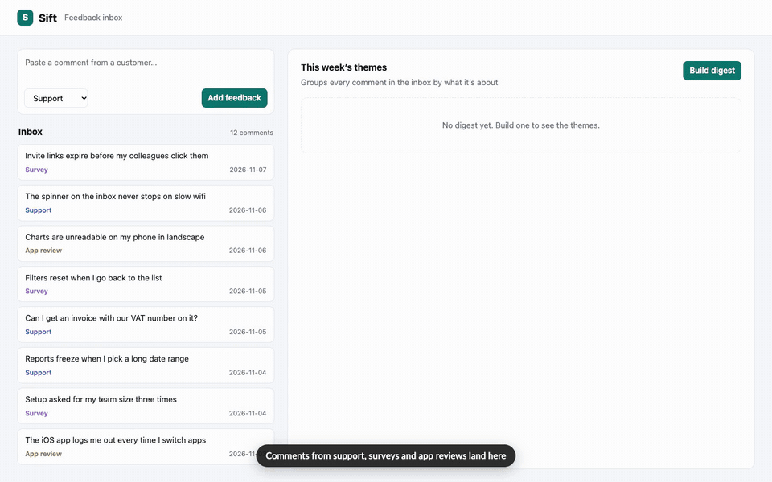

# demo-video (Claude Code skill)

Records scripted demo videos of a running web app in one house format: 1440×900 MP4,
white title cards, pill captions, click ripples, and slow waits sped up. Claude Code uses
it when you ask for a demo video, a walkthrough recording, or an animated architecture
diagram. `SKILL.md` is the skill itself.

## Example

[](examples/sift/sift-demo.mp4)

**[Watch the full video (1:00, MP4)](examples/sift/sift-demo.mp4)**

[`examples/sift/`](examples/sift) is a small real app, Sift, a feedback inbox that groups
comments into themes, plus everything that recorded the video above:

- `app/`: the app itself, one Node process with no dependencies (about 300 lines);
- `demo.json`: the manifest (segments, the service the video needs, how to reset);
- `record-walkthrough.js`: the walkthrough segment, written on `scripts/demo-kit.js`;
- `architecture.html`: the scene page for the architecture segment (arrow keys step through it live).

The walkthrough is the real app doing real work. The one wait, the digest job, is
fast-forwarded. The job paces itself at 450ms per comment so it has progress to show.

Re-record it from the repo root:

```sh
npm install
node examples/sift/app/server.js &      # http://localhost:4318
node scripts/record.js examples/sift    # writes examples/sift/sift-demo.mp4
```

## Install

```sh
git clone https://github.com/lyonsv/demo-video-skill.git ~/.claude/skills/demo-video
```

It needs Node, Google Chrome, and a demos repo (default
`~/src/demos`, or `$DEMOS_REPO`) with `playwright-core` and `ffmpeg-static` installed. The
skill creates that repo if it's missing.

## Contents

- `SKILL.md`: the format, the workflow, and the pitfalls to avoid.
- `scripts/`:
  - `demo-kit.js`: the recording library;
  - `record.js`: records a video from its manifest;
  - `find-demos.js`: lists videos;
  - `encode.js`, `record-scenes.js`, `concat.js`, `review.js`: encoding, scene recording, joining and stills review.
- `assets/`: an architecture scene page template and a worked walkthrough example.
- `examples/sift/`: the example app and its video folder.
